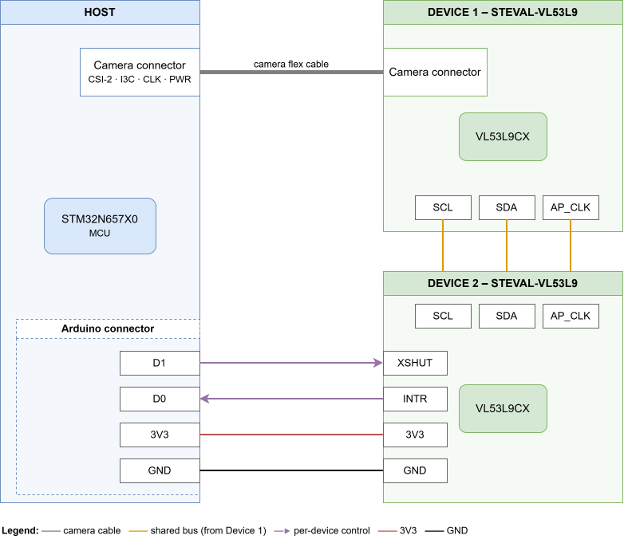
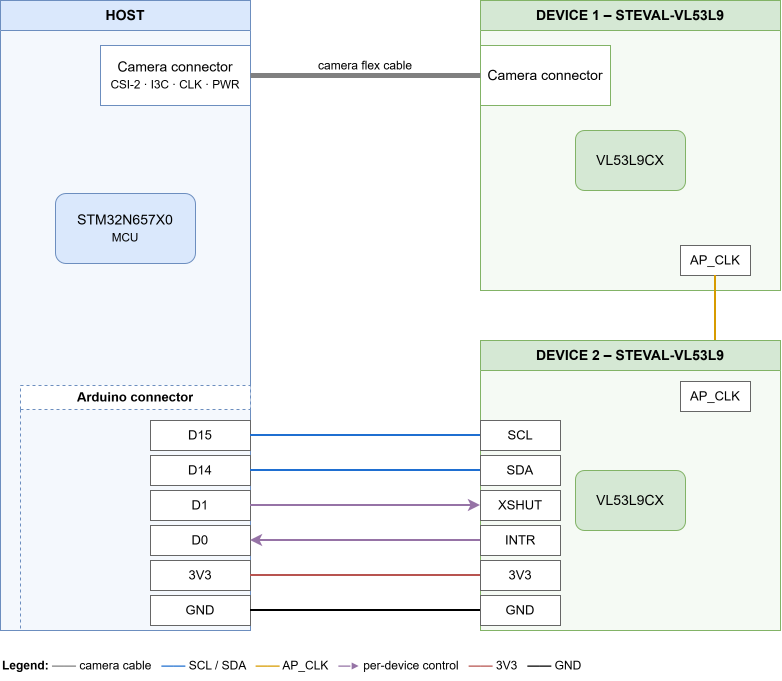

# NUCLEO-N657X0-Q Firmware for VL53L9

## Disclaimer

> Use of control adjustments, or procedures other than those specified in product datasheet may result in hazardous product behavior.


## Introduction

This package provides a NUCLEO-N657X0-Q firmware project with example applications showcasing the VL53L9 Time-of-Flight 3D LiDAR sensor. The applications illustrate the complete flow: initializing the platform, configuring the sensor through the driver, retrieving frames, and processing them through the software ISP.


## Package Layout

This release package is a self-contained STM32CubeIDE project. Its content is listed below.

```text
├── app/
│   ├── ranging_csi/                Single-sensor ranging over MIPI CSI-2
│   ├── ranging_i3c/                Single-sensor ranging over I3C
│   └── ranging_multi_i3c/          Multi-sensor ranging over I3C
├── drivers/
│   └── vl53l9/                     Core driver exposing functions to configure the sensor and retrieve data
├── interface/
│   ├── platform/                   Platform utilities (bus management, event handling, profiling, display, ...)
│   └── vl53l9/                     Platform operations required by the core driver (read/write, delay, ...)
├── lib/
│   ├── media-object/               Media Object class definitions
│   └── transform/                  VL53L9 postprocessing library (software ISP)
├── platform/
│   ├── Drivers/                    CMSIS + STM32N6xx HAL drivers
│   ├── vl53l9-nucleo-n657.ioc      STM32CubeMX project file
│   └── FSBL/                       First Stage Boot Loader
│       ├── Core/                   Peripheral and system initialization (CubeMX-generated)
│       ├── .project / .cproject    STM32CubeIDE project files
│       ├── STM32N657X0HXQ.ld       Linker script
│       └── *.launch                Run/Debug configurations (one per application)
├── CHANGELOG.md                    Revision log
├── LICENSE.md                      License terms
└── README.md                       This file
```


| Component            | README                                 |
|----------------------|----------------------------------------|
| `app`                | [Click here](app/README.md)            |
| `driver`             | [Click here](drivers/vl53l9/README.md) |
| `vl53l9-transform-c` | [Click here](lib/transform/README.md)  |

## Configuration

### Hardware

This software package is intended to be used with following hardware:
- [X-NUCLEO-53L9A1](https://www.st.com/en/evaluation-tools/x-nucleo-53l9a1.html) expansion board: to be plugged into the Arduino connector
- [STEVAL-VL53L9](https://www.st.com/en/evaluation-tools/steval-vl53l9.html) evaluation board: to be plugged into the camera connector or wired to the Arduino connector (see table below)

| Sensor Pin | Arduino Pin |
|------------|-------------|
| SDA        | D14         |
| SCL        | D15         |
| INTR       | D0          |
| XSHUT      | D1          |
| SYNC_IN    | A3          |
| AP_CLK     | D11         |

Please refer to the board's User Manual documents for more details.

#### Multi-device

The recommended way to build a multi-sensor design is to use two STEVAL-VL53L9 boards, with either a shared or a separate I3C bus (see below). A combination of STEVAL-VL53L9 and X-NUCLEO-53L9A1 is also possible, but it is not the recommended setup.

##### Shared I3C bus

When a first STEVAL-VL53L9 is plugged into a camera connector, it is possible to enable a second device by wiring its SDA, SCL, AP_CLK pins to the corresponding pins of the first one. This connects both devices to the same I3C bus, clock, and power supply. In that case, INTR and XSHUT, 3V3, GND must be wired to the Arduino connector accordingly to the table above as shown in the diagram below.



To trigger one device's acquisition from another, connect the triggering device's INTR pin to the target device's SYNC_IN pin (in such case the target device must be programmed in `SLAVE` synchronization mode).

##### Separate I3C bus

You may want to have the devices using two separate I3C interfaces to reduce bus congestion and optimize performances. In that case the second device must be wired to the Arduino connector in order to make use of a different I3C instance. Rather than generating a second AP_CLK, it is recommended to share the clock by wiring the AP_CLK pins of both devices together, as shown in the diagram below.



### Software

Software configuration is done through the following files:

- `app/vl53l9_app_conf.h`: Application configuration (i.e. device instance, ranging profile, frame display, shared bus, ...)

- `interface/vl53l9/vl53l9_device_conf[.h|.c]`: Hardware configuration descriptor for the connected devices. Each entry of the array describes the properties of the hardware setup and the connection pins. To enable additional devices, add entries to the source file and update `NB_DEVICES` symbol in the header to match. The following snippets show an example:

    ```c
    /* in vl53l9_device_conf.h */
    #define NB_DEVICES (2U)
    ```

    ```c
    /* in vl53l9_device_conf.c */
    {
        .bus = &hi3c<x>, // TODO: replace <x> with your handle instance
        .bus_type = PLATFORM_BUS_I3C,
        .address = VL53L9_DEFAULT_7BIT_ADDRESS, // default
        .instance_id = 0x0, // default
        .vdda = VDDA_2V8,
        .vddio = VDDIO_1V8,
        .ext_clock = 12.5e6,
        .intr = { .pin = INTR_ARD_Pin, .port = INTR_ARD_GPIO_Port },
        .xshut = { .pin = XSHUT_ARD_Pin, .port = XSHUT_ARD_GPIO_Port },
        .sync = { .pin = SYNC_ARD_Pin, .port = SYNC_ARD_GPIO_Port }
    },
    ```

## Quickstart with STM32CubeIDE

### Open and import the project

1. Launch STM32CubeIDE and import the project available within the `platform` folder.

    *File -> Import -> Existing Projects into Workspace -> Select root directory -> Browse -> `platform` -> Finish*

2. Only the `FSBL` project is necessary (other projects can be unchecked during import).


### Select active build configuration and build project

1. Choose the application to build from the available build configurations.

    *Project -> Build Configurations -> Set Active -> `<application>`*

2. Build the project with the selected build configuration.

    *Project -> Build Project*


### Run / Debug the firmware

On the NUCLEO-N657X0-Q, the boot mode is selected with the on-board BOOT0 (JP1) and BOOT1 (JP2) jumpers:

| Boot mode       | BOOT0   | BOOT1   | Description                                          |
| --------------- | :-----: | :-----: | ---------------------------------------------------- |
| Debug           |   1-2   |   2-3   | Development boot, firmware loaded from RAM           |
| Boot from flash |   1-2   |   1-2   | Application loaded from the external flash on reset  |

#### Run / Debug from RAM

Set the BOOT1 (JP2) jumper to [2-3] to load the firmware from RAM, then:

1. Run the firmware without debug mode.

    *Run -> Run Configurations*

    **OR**

2. Debug the firmware.

    *Run -> Debug Configurations*


#### Boot from flash

> The STM32N6 has no internal user flash, so the firmware is stored in the external flash memory and loaded at startup. On reset, the device's boot ROM reads the signed FSBL image from the external flash and copies it into RAM before executing it, which is why the binary must first be signed and then programmed at the external flash base address (`0x70000000`). This process relies on the STM32CubeProgrammer tools — `STM32_SigningTool_CLI` to sign the binary and `STM32_Programmer_CLI` (together with the matching external loader) to write it to the flash — so make sure STM32CubeProgrammer is installed and available before proceeding.

> Note: the commands below are run from the STM32CubeProgrammer installation folder.

1. Set the BOOT1 (JP2) jumper to [2-3].

2. Sign the binary file produced by the build:

    ```
    ./STM32_SigningTool_CLI -bin "<your_app>.bin" -nk -t fsbl -hv 2.3 -o "<your_app>_trusted.bin" --align
    ```

3. Flash the signed binary file to the external flash:

    ```
    ./STM32_Programmer_CLI -c port=SWD mode=HOTPLUG ap=1 -el ./ExternalLoader/MX25UM51245G_STM32N6570-NUCLEO.stldr -hardRst -w "<your_app>_trusted.bin" 0x70000000
    ```

4. Set the BOOT1 (JP2) jumper to [1-2] and press the reset button to load the application from the external flash memory.


### Serial output

The firmware logs debug information and the measured frame rate over the serial interface.
To view the output, connect a serial terminal to the board and configure it for 921600 baud.
